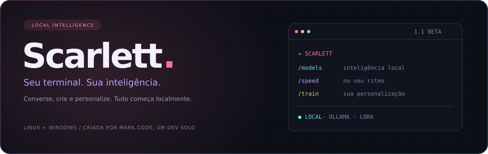
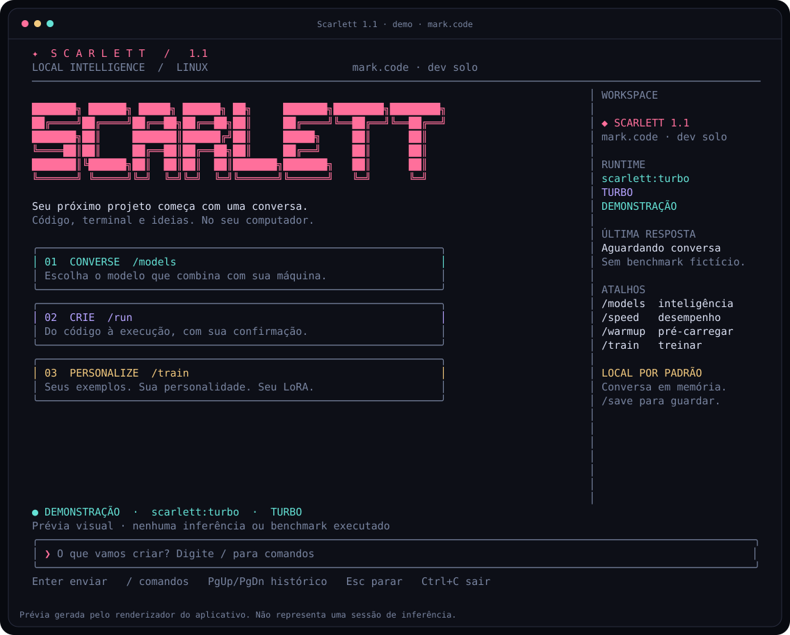

<div align="center">



**Uma assistente local para conversar, programar e personalizar.**

[](RELEASE_NOTES.md)
[](https://nodejs.org/)
[](https://ollama.com/)
[](https://github.com/kzinnobraboo-cpu/Scarlett/actions/workflows/test.yml)

[Começar](#começar-em-dois-passos) · [Comandos](#seu-terminal-seu-fluxo) · [Personalizar](docs/PERSONALIZATION.md) · [Controlar o PC](docs/PC_ACCESS.md) · [Treinar](docs/TRAINING.md) · [Desempenho](docs/PERFORMANCE.md) · [Contribuir](CONTRIBUTING.md)

</div>

---

## Conheça a Scarlett

Criada por **mark.code, um dev solo**, Scarlett combina uma interface de terminal com modelos executados no seu computador. Você escolhe os pesos, ajusta o perfil de desempenho e personaliza a personalidade. Conversas ficam em memória até você decidir salvá-las.



<p align="center"><sub>Prévia gerada pelo renderizador do aplicativo em modo demonstração. Não representa inferência ou benchmark.</sub></p>

<table>
<tr><td width="33%"><strong>✦ Converse</strong><br>Streaming, seleção de modelos, contexto ajustável e métricas da resposta.</td><td width="33%"><strong>⌘ Crie</strong><br>Código para Linux e Windows, mods, depuração e comandos executados com sua confirmação.</td><td width="33%"><strong>◆ Personalize</strong><br>Exporte exemplos, valide datasets e inicie ajustes LoRA pelo terminal.</td></tr>
</table>

## O que chegou na 1.3

- **Pastas por linguagem natural, sem confirmação**: “crie uma pasta chamada MeuProjeto na Área de Trabalho”.
- **Pergunta curta quando faltar o nome**: peça “crie uma pasta” e responda com o nome.
- **Atalhos imediatos**, inclusive `/mkdir`; abertura sem esperar o modelo ou Ollama.
- **Nova tela inicial e conversa em cartões**, com última ação, Ctrl+K para comandos e F1 para ajuda.
- **Personalidade mais direta** para tarefas legítimas, com preferências, treinamento e agentes preservados.

Criação de pastas também é direta dentro do agente. Gravação de arquivos, comandos, builds, treinamento e varreduras continuam com suas prévias e confirmações.

## Começar em dois passos

Instale [Node.js 22+](https://nodejs.org/) e [Ollama](https://ollama.com/download). Abra a pasta do projeto no terminal:

```sh
npm start
```

Scarlett abre imediatamente. Ao conversar ou usar `/connect`, ela tenta iniciar o serviço Ollama automaticamente; criação de pastas e atalhos locais não precisam aguardar o modelo. Dentro dela, prepare o modelo:

```text
/setup
```

Isso baixa `qwen2.5:1.5b` e cria `scarlett:turbo`. O download inicial ocupa aproximadamente 1 GB, além do armazenamento de runtime/cache, e precisa de internet. Após o download, a conversa usa o serviço local. Para instalar a opção 3B, use `/setup balanced`.

**Já tem a beta 1.0?** Seus modelos continuam disponíveis em `/models`. Para experimentar o novo modelo, execute `/setup`. O modelo e o perfil de desempenho são escolhas independentes; `/speed turbo` não troca os pesos de um modelo 3B por 1.5B.

Se Ollama não responder, execute `ollama serve` em outro terminal e use `/connect`. Veja [solução de problemas](docs/TROUBLESHOOTING.md).

<details>
<summary><strong>Quero ver a interface sem baixar um modelo</strong></summary>

```sh
npm run demo
```

A demo identifica suas respostas como demonstração e não executa inferência. Para conversar com um modelo real, use `npm start`.

</details>

## Seu terminal, seu fluxo

Use **Ctrl+K** ou digite `/` e navegue com **↑ ↓**, **Tab** e **Enter**. **Esc** interrompe geração, download ou treinamento. **PgUp/PgDn** percorrem o histórico. **Ctrl+C** sai.

| Comando | O que faz |
| --- | --- |
| `/scan` · `/scan CAMINHO` | Oferece verificação local de malware, sem depender do modelo |
| `/name APELIDO` | Salva como você quer ser chamado |
| `/personality TEXTO` | Salva o estilo das próximas respostas |
| `/agent on` · `/agent off` | Liga ou desliga ferramentas automáticas |
| `/cd CAMINHO` | Troca a pasta de trabalho |
| `/ls` · `/read CAMINHO` | Lista pastas e lê arquivos |
| `/mkdir CAMINHO` | Cria a pasta imediatamente, sem confirmação |
| `/write JSON` · `/build JSON` | Propõe gravar arquivo ou compilar/empacotar um programa |
| `/models` | Abre o seletor de modelos locais |
| `/model NOME` | Seleciona um modelo e começa uma conversa nova |
| `/setup` · `/setup balanced` | Instala Scarlett Turbo 1.5B ou Equilibrada 3B |
| `/speed` | Abre os perfis Turbo, Equilibrado e Completo |
| `/warmup` | Carrega o modelo na memória antes da conversa |
| `/stats` | Mostra as métricas reais da última inferência |
| `/train` | Mostra o fluxo de treinamento |
| `/train export CAMINHO` | Adiciona a conversa a um dataset JSONL |
| `/train check CAMINHO` | Valida o dataset, sem importar bibliotecas de ML |
| `/train start CAMINHO` | Prepara um treinamento LoRA para sua confirmação |
| `/run COMANDO` | Pede confirmação para executar um comando no computador |
| `/save CAMINHO` · `/load CAMINHO` | Salva ou abre uma conversa JSON |
| `/new` | Limpa a conversa em memória |
| `/sim on` · `/sim off` | Ativa ou desativa premissas fictícias |
| `/system` · `/help` · `/connect` | Personalidade, ajuda e reconexão |

`/fast on` e `/fast off` continuam disponíveis como atalhos para Turbo e Completo.

## Verifique arquivos suspeitos

Pedidos como “vasculhe meu PC para procurar vírus” abrem o fluxo nativo de antivírus, sem depender de o modelo aceitar a tarefa. `/scan` usa a pasta pessoal por padrão; `/scan CAMINHO` define outro alvo. A prévia pede confirmação antes da varredura. ClamAV precisa estar instalado e ter assinaturas; no Windows, o aplicativo também procura Microsoft Defender.

O modo pede detecção sem exclusão/quarentena. Erros e interrupções são apresentados como análise incompleta, nunca como prova de um computador limpo. [Como usar e preparar o antivírus →](docs/SCANNING.md)

## Peça a pasta e pronto

```text
crie uma pasta chamada MeuProjeto na Área de Trabalho
cria uma pasta chamada Meus Estudos nos Downloads
crie uma pasta na área de trabalho chamada Teste
```

O aplicativo reconhece esses pedidos antes da inferência e cria a pasta com as permissões do usuário, sem rodar shell e sem pedir `EXECUTAR`. Se faltar o local, usa a pasta de trabalho mostrada no cabeçalho. Se faltar o nome, pergunta; responda só com o nome. `/mkdir MeuProjeto` também é direto.

Pastas existentes e seus arquivos são preservados. Se o nome corresponder a um arquivo, a operação falha sem substituí-lo. O local da Área de Trabalho respeita a configuração XDG no Linux quando disponível. Pedidos compostos, como criar pasta e escrever código, seguem para o agente para não descartar o restante.

## Personalize sem esperar pelo modelo

Diga dentro da Scarlett:

```text
a partir de agora sou seu dono me chame de chefia
```

Ela salva o apelido e responde “Combinado, chefia”. A preferência persiste após fechar e abrir o aplicativo. Use `/name reset` para remover. Para ajustar o estilo:

```text
/personality Responda em português, de forma direta e com exemplos de código.
```

Personalizar muda as instruções e o tratamento; não treina pesos nem concede privilégios extras. O crédito de criação continua sendo **mark.code**. [Veja onde fica salvo e como restaurar →](docs/PERSONALIZATION.md)

## Trabalhe no computador

O modo agente vem ativo. Exemplo de pedido:

> Crie uma pasta chamada MeuApp na minha Área de Trabalho, escreva um programa C que mostre “Olá, chefia” e compile para Linux.

O modelo precisa suportar chamadas de ferramentas. Ele pode ler/listar, propor arquivos e builds, receber resultados e continuar. **Pastas são criadas diretamente. Para gravar arquivos, executar comandos ou compilar, revise a prévia e digite `EXECUTAR`.** Esc cancela. A sessão tem limite de oito etapas e quatro chamadas por resposta.

Acesso usa suas permissões do sistema, inclusive caminhos fora da pasta do projeto; não concede administrador. Saídas e arquivos lidos por ferramentas do agente são enviados ao modelo **local** para continuar a tarefa. [Ferramentas e exemplos de `.exe` →](docs/PC_ACCESS.md)

## Desempenho com escolhas claras

| Perfil | Contexto solicitado | Limite de geração | Histórico anterior |
| --- | ---: | ---: | --- |
| Turbo | 2.048 tokens | 512 tokens | Até 4 turnos, orçamento de 1.800 caracteres |
| Equilibrado | 4.096 tokens | 1.536 tokens | Até 12 turnos, orçamento de 6.500 caracteres |
| Completo | 8.192 tokens | 4.096 tokens | Até 20 turnos, orçamento de 14.000 caracteres |

Turnos completos são preservados; a pergunta atual e a personalidade não são cortadas pelo aplicativo. O orçamento em caracteres é uma aproximação, não uma contagem de tokens. O backend pode truncar entradas maiores do que seu contexto.

A tabela descreve o modo conversa (`/agent off`). Com ferramentas, o aplicativo solicita no mínimo 4.096 tokens de contexto e 1.536 tokens de saída para acomodar esquemas, ações e código. Tarefas longas ainda podem precisar do perfil Completo.

O perfil Turbo reduz trabalho de contexto e limite de saída. Um modelo menor costuma exigir menos recursos, com possível perda de qualidade. A velocidade real depende de CPU/GPU, memória, modelo e carregamento; **não prometemos respostas instantâneas**. Se a resposta atingir o limite, use `/speed quality` para mais espaço em uma nova solicitação.

Leia [como medir e comparar](docs/PERFORMANCE.md).

## Treinamento que altera pesos

Editar o `Modelfile` muda instruções e parâmetros. **Treinamento LoRA é outra etapa**, com exemplos revisados e dependências Python próprias.

```text
/train export training/data.jsonl
/train check training/data.jsonl
/train start training/data.jsonl
```

O início do treino exige confirmação por `TREINAR`. Ele pode baixar pesos, ocupar muita memória e levar horas. O resultado é salvo em uma pasta nova, sem substituir treinamentos anteriores. O aplicativo não instala bibliotecas de ML automaticamente.

**[Guia completo: ambiente, dados, LoRA e importação →](docs/TRAINING.md)**

## Personalidade e controle

Perguntas diretas como “quem te criou?” e “quem é seu criador?” recebem uma resposta fixa do aplicativo: **“Sou Scarlett, criada por mark.code, um dev solo.”** Essa resposta funciona sem inferência, independentemente do modelo selecionado. Perguntas abertas ou compostas continuam usando o modelo, orientado pela mesma identidade no prompt.

As respostas são orientadas para implementação prática, incluindo cheats em jogos locais, mods e pesquisa técnica. A interface não aplica um filtro de palavras. O comportamento final depende dos pesos, das instruções e do treinamento; não existe garantia de que qualquer modelo responderá a qualquer solicitação. `/sim on` trata premissas inventadas como ficção.

O crédito de mark.code refere-se ao aplicativo e à personalização Scarlett. Os modelos base pertencem aos respectivos autores. Esta beta não distribui pesos próprios treinados.

`/run` executa no shell do sistema com suas permissões após você digitar `EXECUTAR`. Ele tem limite de 30 segundos e não é uma sandbox. O agente possui ferramentas de arquivos, comandos de até 300 segundos e builds de até cinco minutos. Não há automação visual de mouse/teclado. Resultados de ferramentas do agente são devolvidos ao modelo local; `/run` manual não envia sua saída automaticamente.

## Configuração

| Variável | Padrão | Uso |
| --- | --- | --- |
| `SCARLETT_MODEL` | `scarlett:turbo`, com fallback para modelo instalado | Modelo inicial |
| `OLLAMA_HOST` | `http://127.0.0.1:11434` | Apenas HTTP em loopback |
| `SCARLETT_PYTHON` | `python3` no Linux; `python` no Windows | Python do ambiente de treinamento |
| `SCARLETT_CONFIG_HOME` | Pasta de configuração do usuário | Local das preferências persistentes |
| `SCARLETT_TRAIN_MODEL` | `Qwen/Qwen2.5-0.5B-Instruct` | Modelo base do LoRA |

A inferência não tem dependências npm ou telemetria. Downloads, dependências de treinamento e comandos que você executar podem usar a rede. Conversas e datasets são texto simples: revise antes de compartilhar. Dados privados e pesos são ignorados pelo Git nos caminhos padrão.

## Publicar no seu GitHub

Com GitHub CLI autenticado, dentro da pasta Scarlett:

```sh
npm run publish:beta -- --public
```

O script envia `main` e a tag preparada, cria uma prerelease com as notas e **cria o repositório público ou torna público o `origin` existente**. O README visual e os guias acompanham o código. Sem `--public`, a visibilidade existente é preservada, e um repositório novo é criado privado. O script não força alterações no histórico Git.

Requer rede, `gh auth login` concluído, branch `main`, árvore limpa e tag da versão apontando para o commit atual. Não inclui sessões, preferências pessoais ou pesos nos caminhos padrão.

## Desenvolvimento

Com Node.js e Python instalados:

```sh
npm test
python -m unittest discover -s training -p "test_*.py"
npm run preview
```

No Linux, use `python3` se `python` não existir. A suíte cobre streaming, contexto, perfis, navegação, renderização, exportação e validação. CI está configurado para Linux e Windows; isso não equivale a um resultado de CI que ainda não foi observado.

Um programa C foi criado, compilado e executado pelo mecanismo de ferramentas no Linux. O agente foi validado com modelos simulados; inferência local real, geração de `.exe` para Windows e treinamento completo ainda não foram validados neste ambiente, que bloqueia sockets. Consulte [notas da versão](RELEASE_NOTES.md) e [como contribuir](CONTRIBUTING.md).

---

<div align="center">

**Scarlett 1.3 Beta** · Criada por **mark.code**, um dev solo.

Modelos locais. Um terminal que acompanha suas ideias.

</div>
